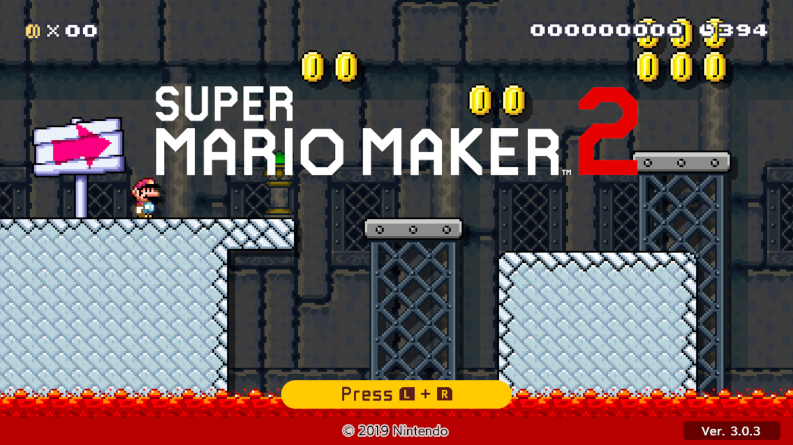

# smm2-dx

**Super Mario Maker 2, running as a normal Windows program.** No emulator, no console. Just double-click and play.

<table align="center">
  <tr>
    <td align="center"><br><sub>The main window</sub></td>
    <td align="center"><br><sub>Course World, online through OpenCourse World</sub></td>
  </tr>
</table>

## Why this exists

Most projects like this try to do everything: every game, every platform, every online service. That makes them big,
hard to follow and hard to fix. This one goes the other way. It is a single-purpose project that does one thing:

- **One game:** Super Mario Maker 2, version 3.0.3.
- **One platform:** Windows.
- **One online service:** [OpenCourse World](https://opencourse.world).

Doing less means less code, and code that does what it says and is easier to keep working. Anything that doesn't serve
those three things stays out.

This project is built for fans and for preservation. It is not a way to get the game for free (see "What you need").

## What you get

- The game as a native Windows app, run through your graphics card (Vulkan).
- Mouse and keyboard in the Course Maker: right click to erase, middle click to drag the course, number keys for the
  palette, Ctrl+Z to undo.
- Sharper graphics and smoother scaling than the console.
- Online play, Course World and uploads through your own OpenCourse World account.
- Mods: drop-in changes made by the community.
- A setup screen that does the awkward parts (unpacking your game and keys) for you.

## What you need

This project does **not** include the game, and never will. You bring your own copy, dumped from a console you own:

1. **Super Mario Maker 2, version 3.0.3** (as folders, or as an NSP / XCI file).
2. **Your `prod.keys`** file, from your console.
3. **The console firmware.** The game needs one font from it (the button icons) or it crashes.
4. **An [OpenCourse World](https://opencourse.world) account**, for everything online. Export your `ocw-config.json`
   and pick it on the setup screen. It stays where it is, and your token is never shown or written to a log.
5. **A PC with Windows 10 or 11 and a Vulkan-capable graphics driver** (anything from the last several years).

## How to get started

1. Download the latest zip from the [Releases](../../releases) page.
2. Unzip it and keep the `.exe` and the `smm2-dx_data` folder together.
3. Run `smm2-dx-windows-x86_64.exe` and follow the setup screen. It only asks for the five things above.

That's it. If something goes wrong, the log is in the `smm2-dx_log` folder next to the exe.

## Build it yourself (it's easy)

You don't have to trust a download. You can build the app from the source in this repo, and it takes one line. There is
nothing to install first: no Visual Studio, no MSYS2, no compiler setup. If you have Windows 10 or 11, you have
everything you need. Open Command Prompt or PowerShell and paste:

```
cmd /c "git clone https://github.com/sometimes-steve/smm2-dx smm2-dx && cd smm2-dx && build-helper.cmd"
```

A little helper called the **Build Helper** fetches the tools it needs, builds the app and puts it in the `dist` folder,
ready to run. To rebuild later, run `build-helper.cmd` again. No game files are needed to build. You only give those to
the setup screen when you run the app.

## Where everything comes from

Nothing but our own code lives in this repo: no game, no keys, no downloaded tools. The Build Helper gets each tool
from its official home:

- the **zig** compiler from ziglang.org
- **SDL3**, **Vulkan** and **shaderc** from the MSYS2 package repository
- **Python** from the python-build-standalone project on GitHub
- **hactool** (unpacks game files) from its GitHub page, built from source
- a few small **Python packages** from PyPI

Every download is checked against a fixed checksum (sha256) written in the source, so a file that has been swapped or
damaged is rejected. If you would rather not let the Build Helper download anything, you can fetch each file yourself
and drop it in the right folder. The exact links, versions and checksums are in the developer section below.

## Support the project

If you enjoy my work, consider buying me a coffee! https://buymeacoffee.com/sometimes_steve

## Credits

Built on top of [LAS Recomp](https://github.com/peiikai/LASRecomp), with ideas from
[SuperMarioWonderRecomp](https://github.com/BelmanteGu/SuperMarioWonderRecomp). See
[recomp/UPSTREAM.md](recomp/UPSTREAM.md) for the details and licenses. Super Mario Maker 2 belongs to Nintendo; this
project is not affiliated with or endorsed by them.

---

# For developers

## How it works

The game's machine code is translated ahead of time into C (the *recompiler*, in `recomp/tools/`), and that C is
compiled into a native Windows program on your machine, from your own dump. The *runtime* (`recomp/runtime/`)
stands in for the console's operating system, services and GPU (NVN on top of Vulkan). `recomp/games/smm2/` holds
the game-specific glue, patches and mods. Nothing of the game is stored in this repo.

- `recomp/`: the player app (runtime, setup screen, recompiler). This is what produces `smm2-dx-windows-x86_64.exe`.
- More detail: [recomp/docs/](recomp/docs), [recomp/docs/mods.md](recomp/docs/mods.md).

## Building on Windows

The **Build Helper** builds everything on Windows with nothing to install first: no MSYS2, no Visual Studio, no
compiler. It needs only Windows 10 or 11 (the `curl` and `tar` that come with Windows).

```
cmd /c "git clone https://github.com/sometimes-steve/smm2-dx smm2-dx && cd smm2-dx && build-helper.cmd"
```

That one line works from cmd or PowerShell and clones into `smm2-dx\` in the current folder. To rebuild later, run `build-helper.cmd` inside it, with options such as `--clean` after it. It fetches what it needs, builds, and
leaves the finished app in `dist\`: `smm2-dx-windows-x86_64.exe` and one folder, `smm2-dx_data\`, which holds the runtime, its
DLLs, Python, zig, hactool, your saves and settings, and `work\` (the build's intermediates and fetched tools). Keep the
exe and its folder together. No game dump is needed to build.

| Option | What it does |
|---|---|
| `--run` | starts the app when the build is done |
| `--no-banner` | prints a one-line header instead of the title banner |
| `--clean` | deletes the compiled objects first (the fetched tools are kept) |
| `--jobs n` | files compiled at once (default: one per logical processor) |

### Where everything comes from

Nothing below is stored in this repo. **Everything can be pulled by the Build Helper, or downloaded by hand.** The Build
Helper downloads each piece from the source below and checks it against a pinned sha256 (listed in
`recomp/tools/build.py`; the Python one also in `build-helper.cmd`). A piece that is missing, half fetched or broken is fetched again on the next run.

To download a piece yourself instead, save the file under the name shown into `dist\smm2-dx_data\work\dl\` (in the
folder shown). If the file's sha256 matches, the Build Helper uses it and doesn't download anything.

| Piece | Version | Download from | Save as, in `work\dl\` |
|---|---|---|---|
| zig compiler (builds the exe, and compiles the game code on the player's machine) | 0.17.0 | [ziglang.org/download/0.17.0](https://ziglang.org/download/0.17.0/zig-x86_64-windows-0.17.0.zip) | `zig-dl\zig-x86_64-windows-0.17.0.zip` |
| SDL3, libiconv (SDL3's dependency), shaderc | 3.4.18, 1.19, 2026.4 | [repo.msys2.org/mingw/ucrt64](https://repo.msys2.org/mingw/ucrt64/) | `msys2\mingw-w64-ucrt-x86_64-sdl3-3.4.18-1-any.pkg.tar.zst`, `...-libiconv-1.19-1-any.pkg.tar.zst`, `...-shaderc-2026.4-1-any.pkg.tar.zst` |
| Vulkan headers, Vulkan loader, Vulkan Memory Allocator (build time only) | 1.4.363, 1.4.363, 3.4.0 | [repo.msys2.org/mingw/ucrt64](https://repo.msys2.org/mingw/ucrt64/) | `msys2\mingw-w64-ucrt-x86_64-vulkan-headers-1~1.4.363.0-1-any.pkg.tar.zst`, `...-vulkan-loader-1~1.4.363.0-1-any.pkg.tar.zst`, `...-vulkan-memory-allocator-3.4.0-1-any.pkg.tar.zst` |
| Python (runs the recompiler and the setup scripts) | 3.12.14 | [python-build-standalone 20260924](https://github.com/astral-sh/python-build-standalone/releases/tag/20260924) | `cpython-3.12.14+20260924-x86_64-pc-windows-msvc-install_only_stripped.tar.gz` |
| capstone, unicorn, lz4 (the recompiler's Python packages) | 5.0.9, 2.1.4, 4.4.5 | PyPI, as pinned by hash in `recomp/tools/requirements-gen.txt` | fetched with pip by the Build Helper |
| hactool (unpacks the firmware; built from source with zig) | 1.4.0 | [github.com/SciresM/hactool](https://github.com/SciresM/hactool/archive/refs/tags/1.4.0.tar.gz) | `hactool-1.4.0.tar.gz` |

#### Pinned sha256

A file is used only if its sha256 matches. Check one by hand with `certutil -hashfile <file> SHA256`. The same values are
in `recomp/tools/build.py` (the Python one also in `build-helper.cmd`).

| File | sha256 |
|---|---|
| `zig-x86_64-windows-0.17.0.zip` | `b5663f69581dcf391293fbf16c06cb80d81d806545ce618b4d0bab7f0eb8c428` |
| `mingw-w64-ucrt-x86_64-sdl3-3.4.18-1-any.pkg.tar.zst` | `f9f8e2fe9858868e7653b24c973bcc8c19dea1096afc8c905bf1cd1a87960442` |
| `mingw-w64-ucrt-x86_64-libiconv-1.19-1-any.pkg.tar.zst` | `9a500f38c2b91808741c62fae746b3e9110b33a1ecf5c30fa0c66dbedddf7e16` |
| `mingw-w64-ucrt-x86_64-shaderc-2026.4-1-any.pkg.tar.zst` | `a4ad271f76acd2307ed67738770b30d6486bd3c7acff63ba83dd13e56ce9ab82` |
| `mingw-w64-ucrt-x86_64-vulkan-headers-1~1.4.363.0-1-any.pkg.tar.zst` | `be602b2657cace531316e78b1eda4087e8f7f84ebb877f08fba198a2db06406a` |
| `mingw-w64-ucrt-x86_64-vulkan-loader-1~1.4.363.0-1-any.pkg.tar.zst` | `065076fe13d39ab97eea4740596426d5ae741b5044e48e1c9495d04835c92dbe` |
| `mingw-w64-ucrt-x86_64-vulkan-memory-allocator-3.4.0-1-any.pkg.tar.zst` | `44c81162337915afecda3185f66fd98268a54454580b2717080c9dfef57fe781` |
| `cpython-3.12.14+20260924-x86_64-pc-windows-msvc-install_only_stripped.tar.gz` | `c5bf8edfe858c1df9891be498b5bbc8761d383df5b9790658b088fea4870433a` |
| `hactool-1.4.0.tar.gz` | `1373c98ef8c58da42cb1e81b361283955caad0e1b8b5ad389b0ee49b7a21da43` |

The Python packages (capstone, unicorn, lz4) are checked by pip against the hashes in `recomp/tools/requirements-gen.txt`.

Then `recomp/tools/build.py` copies the recompiler scripts, the headers the game code is built against, and the
licenses into `smm2-dx_data`, so the app finds everything beside itself.

The game files, keys and firmware are never downloaded. You supply those through the setup screen.

Logs are written to `smm2-dx_log\`, next to the exe.
